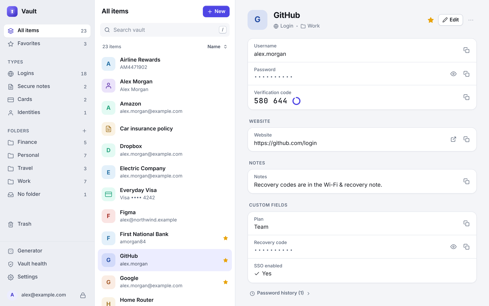
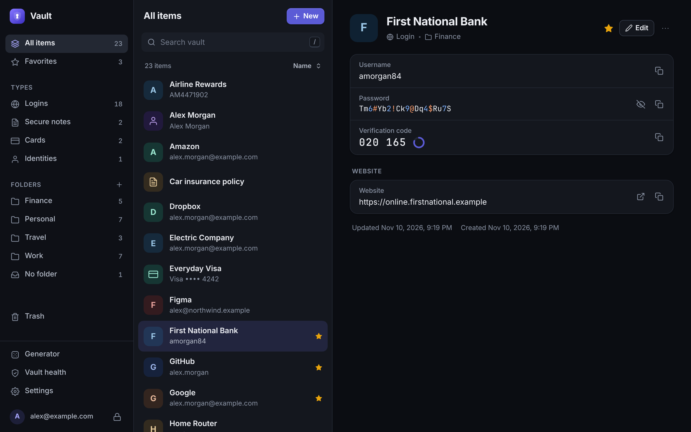
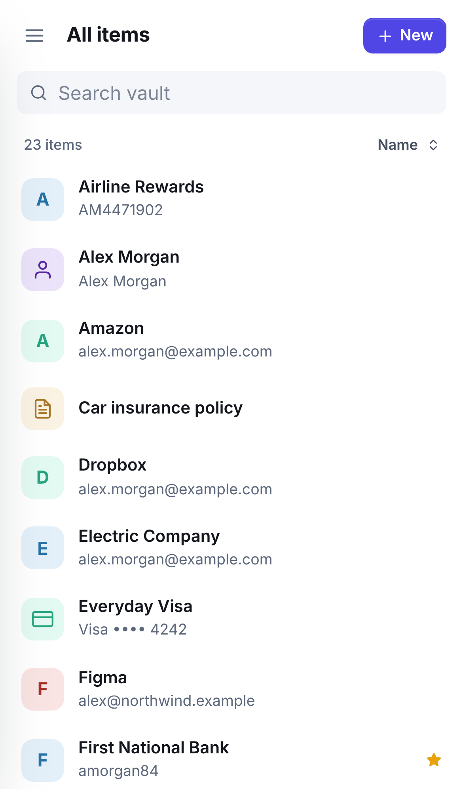
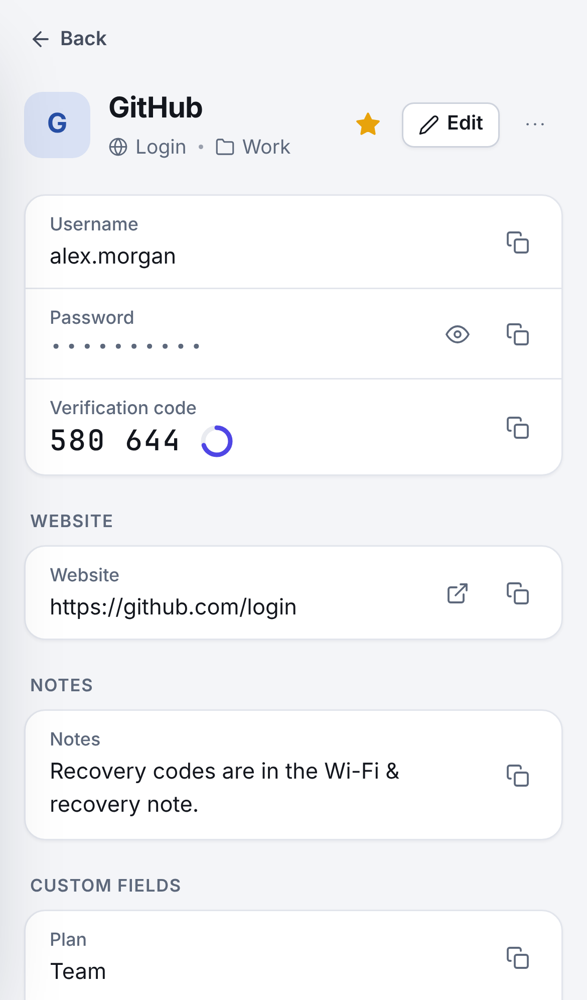
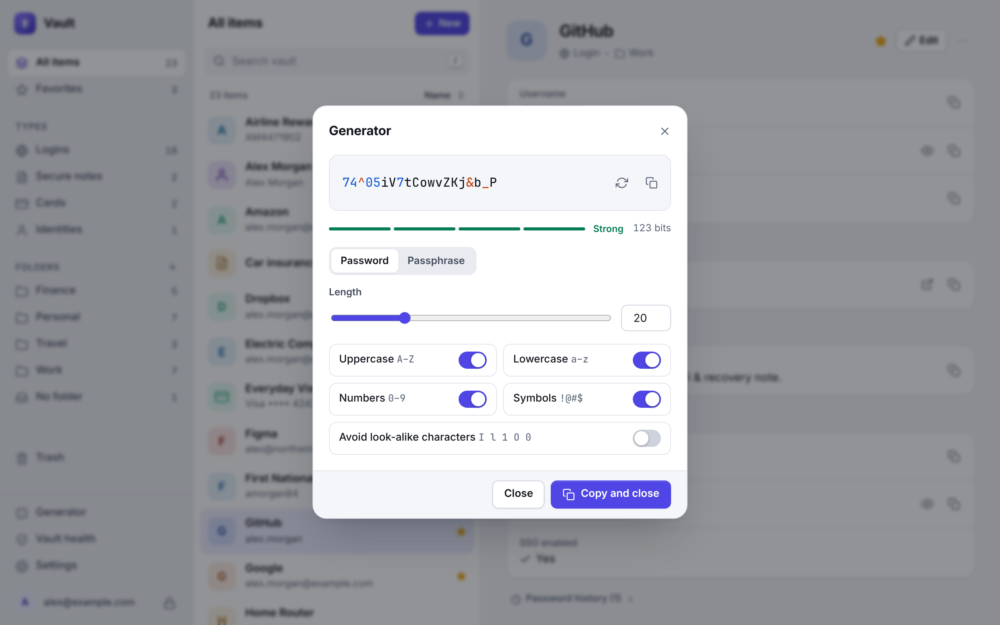

# Vault

A private password manager you run yourself. Store logins, websites, cards, identities and secure notes behind one master password, with a clean interface that works on desktop and phone.

Everything is encrypted in your browser before it is saved, so the server only ever holds data it cannot read.



<p>
  
  
  
</p>

## What it does

- **Logins, cards, identities and secure notes**, with several websites per login, custom fields (text, hidden, checkbox) and free-form notes.
- **Folders, favorites, instant search and a trash** that keeps deleted items for 30 days.
- **Password and passphrase generator**, with a strength meter everywhere a password is typed.
- **Two-step login codes (TOTP)**: paste a site's authenticator key and Vault shows the live 6-digit code.
- **Vault health**: finds weak, reused and unencrypted (`http://`) logins, and can check your passwords against known data breaches.
- **Password history**: replaced passwords are kept with the item, so a mistaken change can be undone.
- **Import from Bitwarden** (JSON or CSV), Chrome, Edge, Firefox, Safari, 1Password, LastPass, KeePass and other CSV exports.
- **Export** as an encrypted backup, or as Bitwarden-format JSON or CSV, so your data is never locked in.
- **Syncs between devices and browser tabs**, with protection against one device overwriting another's changes.
- **Locks itself** after a period of inactivity, clears copied passwords from the clipboard, and locks every open tab together.
- **Light and dark themes**, a phone layout, and it can be installed to your home screen or dock as an app.



## Getting started

You need [Node.js](https://nodejs.org) 20 or newer. There is nothing else to install: Vault has no dependencies and no build step.

```bash
git clone https://github.com/zallen971/password-vault.git
```

```bash
cd password-vault
```

```bash
npm start
```

Open <http://localhost:8787>, choose a master password, and your vault is ready.

Your encrypted vault is stored in the `data` folder next to the app. Keep that folder; it is your vault.

> **There is no password reset.** Your master password is the key that encrypts everything, and it never leaves your device. If you forget it, nobody can recover your vault. Choose a phrase of four or five unrelated words, and keep an [encrypted backup](#backups).

## Moving from Bitwarden

1. In Bitwarden, open **Tools → Export vault** (or **File → Export vault** in the desktop app).
2. Choose the file format **.json** and export. The two "encrypted" formats can only be read by Bitwarden itself.
3. In Vault, open **Settings → Import** and drop the file in.
4. Delete the export file, and empty the bin. It contains every password unprotected.

Logins, notes, cards, identities, folders, favorites, custom fields, authenticator keys and password history all come across. Importing the same file twice does not create duplicates.

Two things cannot be transferred, because Bitwarden does not export them in a usable form: passkeys and file attachments.

## Using it from your phone and other computers

Browsers only allow the encryption Vault relies on over **HTTPS** (the one exception is `http://localhost` on the computer running it). To reach your vault from other devices, it has to be served over HTTPS. There are two ways.

### Docker with automatic HTTPS

If you have a domain name pointing at the machine, the included Compose file runs Vault behind [Caddy](https://caddyserver.com), which obtains and renews a certificate for you:

```bash
VAULT_DOMAIN=vault.example.com docker compose up -d
```

Ports 80 and 443 need to be reachable from the internet for the certificate to be issued.

To run the container on its own, for example behind a reverse proxy you already have:

```bash
docker build -t password-vault .
```

```bash
docker run -d --name vault --restart unless-stopped -p 127.0.0.1:8787:8787 -v vault-data:/data -e TRUST_PROXY=true password-vault
```

### Your own certificate

If you already have a certificate and key, Vault can serve HTTPS directly:

```bash
HOST=0.0.0.0 TLS_CERT=/path/to/cert.pem TLS_KEY=/path/to/key.pem npm start
```

A private network such as Tailscale or a VPN is a good way to reach a home server without exposing it to the whole internet.

## Settings

Vault is configured with environment variables. The defaults suit running it on your own computer.

| Variable | Default | What it does |
| --- | --- | --- |
| `PORT` | `8787` | Port to listen on. |
| `HOST` | `127.0.0.1` | Address to listen on. The default accepts connections from this computer only; use `0.0.0.0` to accept them from the network. |
| `DATA_DIR` | `./data` | Where the encrypted vaults are stored. |
| `ALLOW_SIGNUPS` | *(unset)* | Unset: new accounts can be created only until the first one exists. `true`: anyone who can reach the server can create an account. `false`: nobody can. |
| `TRUST_PROXY` | `false` | Set to `true` when Vault runs behind a reverse proxy, so it reads the visitor's address and HTTPS status from the proxy. Leave it off otherwise. |
| `TLS_CERT`, `TLS_KEY` | *(unset)* | Paths to a certificate and private key, to serve HTTPS directly. |
| `BACKUP_DAYS` | `14` | How many daily snapshots of each vault to keep. `0` turns snapshots off. |

On Windows, set a variable before starting with `set NAME=value` (Command Prompt) or `$env:NAME="value"` (PowerShell), then run `npm start`.

To give a family member or colleague their own vault, start the server once with `ALLOW_SIGNUPS=true`, let them create their account, then remove the setting again. Each account is separate; there is no sharing between accounts.

## Backups

Losing the `data` folder means losing your vault, so back it up. Three layers are available:

- **Copy the `data` folder.** It contains only encrypted data, so it is safe to copy to a backup drive or cloud storage as it is.
- **Daily snapshots.** Before the first change each day, Vault saves a copy of each vault to `data/backups/<account>/<date>.json` and keeps the last 14. To roll back, stop the server, copy a snapshot over `data/accounts/<account>.json`, and start it again. A snapshot is opened with the master password that was in use on that day.
- **Encrypted export.** **Settings → Export → Encrypted backup** downloads a single file protected by a password you choose. It can be restored into any Vault server from **Settings → Import**.

## How your data is protected

- **Your master password never leaves your device.** It is stretched with PBKDF2-SHA256 (600,000 rounds) into a master key. From that, two separate keys are derived: one that proves who you are to the server, and one that never leaves the browser.
- **Every item is encrypted with AES-256-GCM** under a random 256-bit vault key, which is itself encrypted with the key that never leaves your browser. Names, usernames, websites, notes, folders, even which type each item is: all of it is inside the encrypted data.
- **The server stores only** your email address, the encrypted records, and a salted hash of the sign-in key. Someone who copies the `data` folder gets nothing they can read without your master password, and nothing they can use to sign in.
- **Each encrypted record is bound to its own identity**, so a tampered server cannot quietly swap one item's contents for another's.
- **Sign-in attempts are rate limited** per account and per address, and signing in does not reveal whether an email address has an account.
- **The page is locked down** with a strict Content Security Policy: no inline scripts, no third-party code, no frames. Vault contents are only ever inserted into the page as text, never as markup.
- **Keys and decrypted items live in memory only**, and are discarded when the vault locks or the tab closes. The browser remembers nothing but your display preferences and, if you allow it, your email address.

Copied passwords are wiped from the clipboard after 30 seconds (you can change this). Browsers limit what a web page may do to the clipboard: Chrome and Edge allow the wipe while Vault is the active window, and otherwise it happens as soon as you return to Vault; Safari and Firefox only allow it when you next click or type in Vault.

The breached-password check is optional and only runs when you ask for it. It uses the [Have I Been Pwned](https://haveibeenpwned.com/Passwords) range service: each password is hashed on your device and only the first 5 characters of the hash are sent, never a password.

### What this does not protect against

Be clear-eyed about the limits, as with any password manager:

- **A weak master password.** Encryption is only as strong as the password behind it.
- **A compromised device.** Malware or a hostile browser extension on a computer where your vault is unlocked can read what you can read.
- **A compromised server serving altered code.** Like every web-based password manager, the app's code is delivered by the server, so you must trust the machine that runs it. That is the reason to host it yourself.
- **A server that replays old data.** A hostile server could serve an older copy of your vault; it could not read or alter the contents.

This project has not had an independent security audit.

## Compared with Bitwarden

Vault covers the core of a password manager. It deliberately leaves out some things Bitwarden has:

- **No browser extension, so no autofill.** You copy and paste, or open the site from the item.
- **No native mobile apps.** The web app is built for phones and can be added to the home screen, but it needs a connection to your server; there is no offline mode.
- **No sharing, organizations or emergency access.** Each account is private.
- **No file attachments or passkeys.**
- **No two-step login for the vault itself.** Protect it with a strong master password, and prefer a private network over exposing it to the internet.

## Development

```bash
npm test
```

runs the unit and integration tests: the server API, the cryptography (including published test vectors), sync conflicts between devices, and import/export round trips.

```bash
npm run test:e2e
```

drives every feature in a real browser. It needs [Playwright](https://playwright.dev), which is not a dependency of the app:

```bash
npm install --no-save playwright && npx playwright install chromium
```

`npm run dev` restarts the server when its files change.

| Path | Contents |
| --- | --- |
| `server/` | The HTTP server: accounts, sessions, rate limiting, and storage of encrypted records. |
| `public/js/lib/` | Everything without a user interface: cryptography, sync, generator, import and export. |
| `public/js/views/`, `public/js/ui/` | The interface, in plain JavaScript modules. |
| `test/` | Unit, integration and browser tests. |

## Credits

Passphrases are generated from the [EFF Large Wordlist](https://www.eff.org/dice) by the Electronic Frontier Foundation, used under the [Creative Commons Attribution 3.0 US](https://creativecommons.org/licenses/by/3.0/us/) licence.
